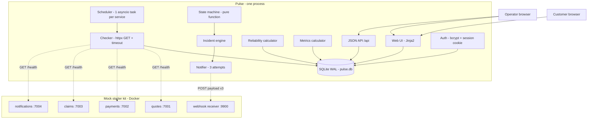
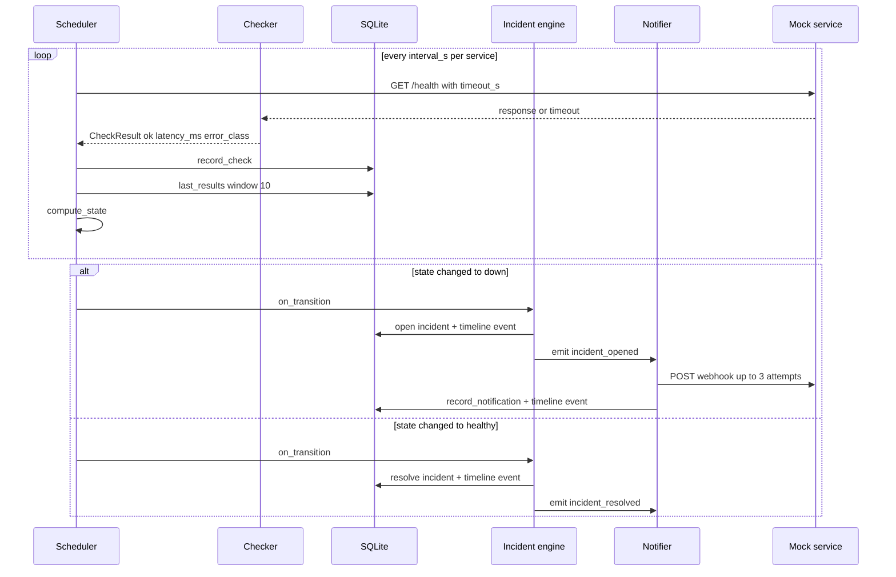
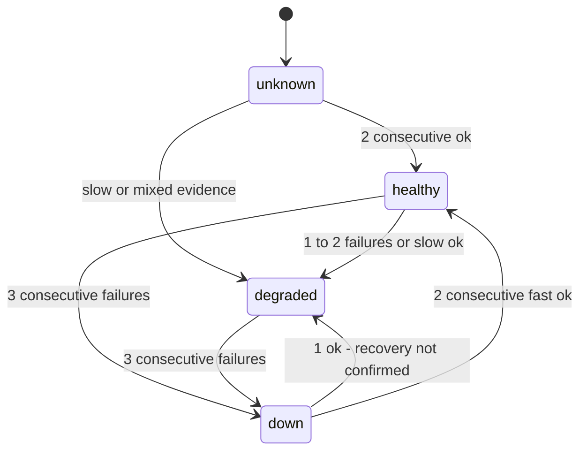
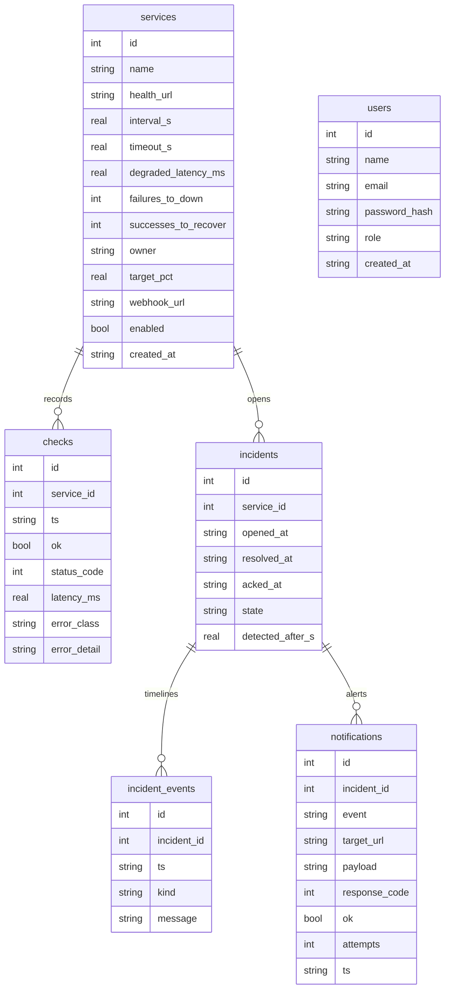

# DESIGN.md — how Pulse works internally

> Design reference for the implemented system. Companion documents:
> [PROJECT_PLAN_V2.md](PROJECT_PLAN_V2.md) (objectives, phases, roadmap) ·
> [PROGRESS_STATUS.md](PROGRESS_STATUS.md) (what is done and verified) ·
> [README_PRODUCT.md](README_PRODUCT.md) (install, run, login, use).
> The original goals live in `PLAN.md` and every post-gate change with its
> rationale in `DECISIONS.md`.

## System architecture

One Python 3.12 process. FastAPI serves both the JSON API and the
server-rendered UI; an asyncio scheduler owns one isolated task per service;
all state lives in a single SQLite database (`pulse.db`, WAL mode).

| Module | File | Responsibility |
|---|---|---|
| Config | `pulse/config.py` | Every env knob with a default (see the [configuration table](README_PRODUCT.md#configuration)) |
| DB layer | `pulse/db.py` | Schema, one process-wide connection, WAL, reentrant-lock write transactions |
| Store | `pulse/store.py` | Every query for the monitoring tables — no SQL anywhere else |
| Users | `pulse/users.py` | `users` table access, bcrypt hashing/verification, registration, bootstrap admin |
| Auth | `pulse/auth.py` | Session helpers and the three route guards (see [Operator authentication](#operator-authentication)) |
| Checker | `pulse/checker.py` | One HTTP GET per check with a per-request timeout; classifies failures; **sanitizer choke-point** |
| State machine | `pulse/state.py` | Pure function `compute_state()` over the last check results (see [State machine](#state-machine)) |
| Scheduler | `pulse/scheduler.py` | One asyncio task per service; restart-safe state re-derivation; syncs on catalogue edits |
| Incident engine | `pulse/incidents.py` | Opens on `down` only, auto-resolves on recovery, manual resolve, timeline events |
| Notifier | `pulse/notifier.py` | Sanitized webhook payloads, 3 attempts with backoff, background delivery, audit log |
| Reliability | `pulse/reliability.py` | Check-weighted uptime over 1 h / 24 h / 7 d vs target, error-budget arithmetic |
| Metrics | `pulse/metrics.py` | MTTD, MTTR, checker success + latency percentiles, notification delivery rate |
| Seed | `pulse/seed.py` | Registers the kit's four services on an empty DB (`PULSE_SEED=0` disables) |
| App wiring | `pulse/main.py` | Lifespan (connect DB → bootstrap admin → seed → start scheduler), `SessionMiddleware`, routers |
| JSON API | `pulse/api/routes.py` | Pydantic-validated endpoints under `/api` (see [API design](#api-design)) |
| Web UI | `pulse/web/routes.py`, `pulse/web/templates/` | Dashboard, service/incident pages, metrics, public status, login, signup |
| Entry point | `run.py` | `python run.py` → Uvicorn on `127.0.0.1:8001` |

## Monitoring engine

### Check cycle

The scheduler runs one asyncio task per enabled service, so a hung service can
only delay its own loop, never the others. Each cycle stores the result, feeds
the last 10 results to the state machine, and fires the incident engine only on
a state transition.

On startup `Scheduler.init_states()` re-derives every service's state from the
stored checks, so a restart never manufactures fake transitions or duplicate
incidents (verified live when Pulse restarted with four services already down).

### State machine

`pulse/state.py` is a pure function — no HTTP, DB or asyncio — so every rule is
unit-tested without Docker or network. Thresholds are per-service catalogue
columns (`failures_to_down` default 3, `successes_to_recover` default 2,
`degraded_latency_ms` default 1000). The evaluation window is the last 10
checks.

Rules, exactly as implemented:

- **down** — the newest-first streak of failures reaches `failures_to_down`; a
  full failure-run anywhere in the window also holds `down` until recovery is
  confirmed, so one lucky success cannot flip state.
- **healthy** — the newest-first streak of successes reaches
  `successes_to_recover` and every one of them is within
  `degraded_latency_ms`.
- **degraded** — everything else: 1–2 failures, slow-but-successful checks,
  flaky mixes, or a recovering service that is still too slow.
- **unknown** — no check results yet.

Only `down` opens incidents; `degraded` merely appends a timeline detail to an
incident that is already open (or logs, if none is open).

### Sanitizer

`checker.py` is the choke-point: a failed check stores a safe `error_class`
token (`timeout`, `conn_refused`, `http_5xx`, `http_4xx`, `http_3xx`, `error`)
plus an `error_detail` that is **internal-only**. Public surfaces render from
the `FRIENDLY` text table ("not responding in time", …) and webhook payloads
are built field-by-field, so internal error text (the kit's planted
`10.12.4.7` string) can never leak. Enforced by 7 sanitizer unit tests and an
acceptance test against the real kit.

## Incident and notification flow

`pulse/incidents.py` (engine) + `pulse/notifier.py` (delivery):

- `down` transition → `store.open_incident()` (only if none open; duplicates
  are logged and skipped) → timeline `opened` + `detail` with friendly reason →
  `notifier.emit(incident_opened)` in a background task.
- `degraded` transition → timeline `detail` on the open incident (if any).
- `healthy` transition → auto-resolve the open incident → timeline `resolved`
  → `notifier.emit(incident_resolved)`.
- Operators can `ack` (state `acknowledged`, timeline `acked`), append `note`
  events at any time, or resolve manually (still notified).

Incident lifecycle timeline kinds, in append order:
`opened` → `detail` / `notified` / `notify_failed` / `acked` / `note` →
`resolved`.

Webhook delivery (`notifier.py`): up to **3 attempts**, backoff of
`1.5 s × attempt`, 5 s per-request timeout, entirely in a background task so a
slow receiver never stalls a check loop. Every attempt outcome is audited in
`notifications` and mirrored onto the incident timeline. Payload fields:
`event`, `pulse_version`, `service`, `service_id`, `incident_id`, `state`,
`opened_at`, `resolved_at`, `summary` — never `error_detail`, never internal
URLs.

MTTD is captured at open time (`detected_after_s` = seconds since the last
successful check) and MTTR is the `opened_at` → `resolved_at` span — both
computed from stored records, never assumed.

## Operator authentication

Implemented in `pulse/users.py` + `pulse/auth.py` on the same `pulse.db`
(additive `users` table; no separate database). Full usage instructions are in
[README_PRODUCT.md → Login and signup](README_PRODUCT.md#login-and-signup).

- **Accounts** — `id, name, email UNIQUE, password_hash, role
  (admin|operator|viewer), created_at`. Emails are normalised to lowercase
  before every lookup and insert.
- **Hashing** — bcrypt with a per-user random salt (salt travels inside the
  hash string). `verify_password()` treats a malformed stored hash as invalid
  instead of crashing. Plain-text passwords are never stored, returned, or
  logged.
- **Sessions** — Starlette `SessionMiddleware` with an itsdangerous-signed
  cookie, `max_age=86400` (24 h), session key `uid` = user id. `PULSE_SECRET`
  signs the cookie; unset → per-process random key with a startup warning
  (logins reset on restart).
- **Guards** — one session, three enforcement styles:

  | Guard | Used by | Anonymous result |
  |---|---|---|
  | `require_api_user` | mutating JSON endpoints | `401` |
  | `require_admin` | `POST /api/users` | `401` anon, `403` non-admin |
  | `require_web_user` | operator HTML pages + form actions | `303` → `/login?next=<path>` |

  The web `next` target is honoured only for same-site paths
  (must start with `/` and not `//`) — no open redirects.
- **Registration** — public, two ways that share one code path
  (`users.register_user()`, always role `operator`):
  - `POST /api/register` — JSON, Pydantic-validated (name 1–100 chars, email
    format ≤200, password 8–200 chars), `201` + auto sign-in, `409` on
    duplicate email. No `role` field: sign-ups cannot self-assign admin.
  - `POST /signup` — server-rendered form with the same rules re-checked
    server-side, per-field error messages, `422` on any failure. The typed
    password is never re-rendered into the page.
- **Bootstrap admin** — on startup, if `users` is empty and
  `PULSE_ADMIN_PASSWORD` is set, one admin is created for `PULSE_ADMIN_EMAIL`
  (default `admin@pulse.local`), idempotently. If the env var is unset, the log
  simply points operators at `/signup`. No password is ever generated or
  written to logs (deliberate change from the earlier random-password design —
  see [PROGRESS_STATUS.md → In progress](PROGRESS_STATUS.md#in-progress) for
  commit status and `DECISIONS.md` for rationale).
- **Public/private split** — `/status`, `/metrics`, `/login`, `/signup` and
  every read-only `/api` GET stay open; operator pages and all mutations
  require a session; account creation with a chosen role requires admin.

## Database design

SQLite in WAL mode, foreign keys ON, one process-wide connection guarded by a
reentrant `threading.RLock`; every write goes through `db.tx(write=True)`
(helpers may nest). Schema changes are additive: `SCHEMA` is a list of
`CREATE TABLE IF NOT EXISTS` statements applied idempotently on connect, so
existing tables and rows are never touched by upgrades.

Notes:

- `checks` is indexed `(service_id, ts)`; `incident_events` is indexed
  `(incident_id, id)` and is append-only.
- `incidents.state` is constrained to `open | acknowledged | resolved`; at most
  one open incident per service exists at a time (enforced by the engine, not
  just convention).
- `checks.error_detail` and `notifications.payload` are the only columns that
  can carry raw failure text; both are excluded from every public surface.
- `users` was added additively for operator login — all monitoring data was
  preserved through the migration (see
  [PROGRESS_STATUS.md → Completed features](PROGRESS_STATUS.md#completed-features)).

## API design

JSON under `/api`, Pydantic-validated. Auth column: `—` public, `login` any
signed-in user, `admin` admin role only.

| Method and path | Auth | Purpose |
|---|---|---|
| `POST /api/login` | — | email + password → session cookie; `401` on bad credentials |
| `POST /api/logout` | — | clear the session |
| `POST /api/register` | — | self-service account (role `operator`); `201` + auto sign-in; `409` duplicate email |
| `GET /api/me` | login | current user (`password_hash` never included) |
| `POST /api/users` | admin | create an account with any role; `409` duplicate email |
| `GET /api/services` | — | catalogue with live state + friendly error text |
| `POST /api/services` | login | create a service (full validation; `409` duplicate name) |
| `GET /api/services/{id}` | — | detail + reliability card (1 h/24 h/7 d) + last 10 incidents |
| `PATCH /api/services/{id}` | login | partial update (thresholds, target, webhook, enabled…) |
| `DELETE /api/services/{id}` | login | remove a service and its records (cascade) |
| `GET /api/status` | — | sanitized customer-facing status + open incidents |
| `GET /api/incidents` | — | list, optional `?state=open|acknowledged|resolved` |
| `GET /api/incidents/{id}` | — | detail with full timeline |
| `POST /api/incidents/{id}/ack` | login | acknowledge |
| `POST /api/incidents/{id}/notes` | login | append a note (`note` 1–2000 chars) |
| `POST /api/incidents/{id}/resolve` | login | manual resolve (still notifies) |
| `GET /api/metrics` | — | incidents, MTTD/MTTR (24 h), checker (1 h), delivery (24 h) |

Error semantics: `400` bad filter or action on a resolved incident · `401`
unauthenticated · `403` non-admin · `404` unknown id · `409` conflict · `422`
validation. Interactive OpenAPI docs at `/docs`.

Web routes mirror the same split: public `/status` (10 s auto-refresh),
`/metrics`, `/login`, `/signup`; login-gated `/` dashboard (5 s refresh),
`/services/{id}`, `/incidents/{id}` and the form actions
`POST /incidents/{id}/ack | /note | /resolve`, `POST /services`. The API uses
`/notes` (plural, JSON); the web form posts to `/note` (singular, form-encoded)
— both append the same timeline event.

## Technology choices

- **FastAPI + Uvicorn** — typed request models give declarative validation;
  one framework serves JSON and server-rendered pages.
- **One asyncio task per service** — fault isolation; per-service
  interval/timeout are independent.
- **Pure state-machine function** — every transition unit-testable without
  HTTP, DB, or asyncio.
- **SQLite (WAL) + single guarded connection** — zero-admin persistence, safe
  concurrent readers, serialized writers; right size for laptop/Docker scale.
- **Jinja2 server-rendered UI, no JS build step** — meta-refresh live pages
  (5 s dashboard, 10 s public status); minimal JS only for the password
  show/hide toggle and live signup feedback.
- **httpx (async)** — shared client for the checker and notifier;
  per-request timeouts.
- **bcrypt + itsdangerous sessions** — industry-standard password hashing with
  per-user salts; signed cookie sessions without a server-side session store.
- **pytest + pytest-asyncio** — layered suites: unit → integration (stub kit +
  webhook over ASGI) → acceptance against the real Docker kit (see
  [PROGRESS_STATUS.md → Test coverage](PROGRESS_STATUS.md#test-coverage)).

## Known limitations

Documented deliberately, not hidden — fixes are specified and scheduled in
[PROJECT_PLAN_V2.md → Future roadmap](PROJECT_PLAN_V2.md#future-roadmap):

1. **Flapping** — a service cycling down/up faster than recovery confirmation
   opens a new incident (and fires a webhook) per cycle. Analysis and the
   planned reopen-window fix: `DECISIONS.md`.
2. **Failed checks record `latency_ms = 0.0`** — the checker only measures
   successful responses today, so latency percentiles read 0 ms during a full
   outage (success rate stays truthful).
3. **Error-budget windows extrapolate** — `used_seconds` scales the observed
   failure ratio across the nominal window even when the database holds less
   history than the window (e.g. "3.9 days of budget used" with 2 h of data).
4. **`PULSE_SECRET` rotation** — without it, restarts invalidate sessions (by
   design, with a logged warning).

Current environment notes (Docker Desktop outage affecting the mock kit) are
tracked separately in
[PROGRESS_STATUS.md → Known issues](PROGRESS_STATUS.md#known-issues).
