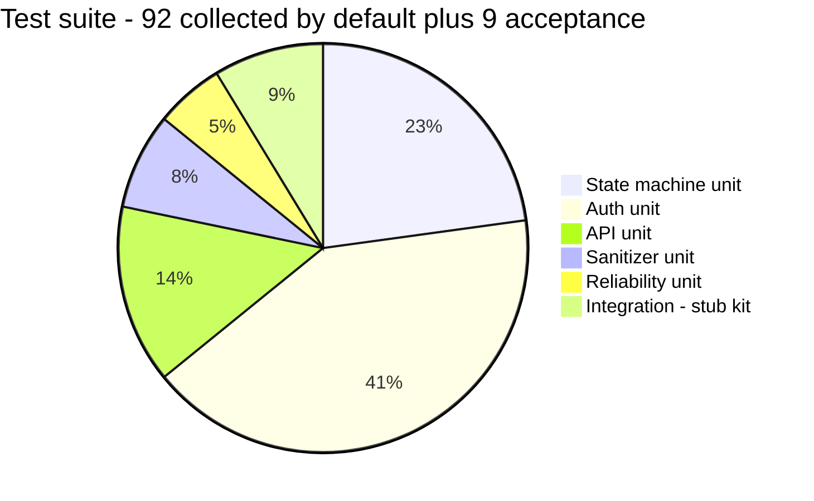

# PROGRESS_STATUS.md — current implementation status

> Live status of the Pulse project. Companion documents:
> [DESIGN.md](DESIGN.md) (system internals) ·
> [PROJECT_PLAN_V2.md](PROJECT_PLAN_V2.md) (objectives, phases, roadmap) ·
> [README_PRODUCT.md](README_PRODUCT.md) (install, run, login, use).

## Current status at a glance

| Area | Status |
|---|---|
| Application code | ✅ Complete and running — Pulse serves `http://localhost:8001` with monitoring, incidents, webhooks, metrics and login/signup live |
| Automated tests | ✅ **92 passed** (84 unit + 8 integration), re-verified against the current tree |
| Acceptance tests | ✅ 9/9 passed in the last full run vs the real kit (auto-skip while the kit is down — currently skipped for that reason only) |
| Database integrity | ✅ Existing monitoring data preserved through the auth upgrade; `users` table holds exactly the bootstrap admin |
| Working tree | ⚠️ All feature + doc changes are **uncommitted**, pending owner approval (deliberately) |
| Mock kit environment | ❌ Docker Desktop engine froze at ~19:38 IST; kit down since 19:40 IST; restart in progress (see [Known issues](#known-issues)) |

## Completed features

Everything below is implemented, tested and (unless the mock kit is down)
verified live. Internal design for each item: [DESIGN.md](DESIGN.md).

| Feature | Module(s) | Verified by |
|---|---|---|
| Service catalogue CRUD + kit auto-seed (`quotes/payments/claims/notifications` → :7001–7004) | `store.py`, `seed.py` | 6 API tests; live seeded rows |
| Isolated health checking — one asyncio task per service, per-request timeout, every attempt stored | `scheduler.py`, `checker.py` | 8 integration tests; live check rows |
| Pure state machine — 3 fails → `down`, 2 confirmed fast ok → `healthy`, else `degraded`; per-service thresholds | `state.py` | 21 state-machine unit tests |
| Incident lifecycle — auto-open on `down` only, auto-resolve, ack, notes, manual resolve, append-only timeline, MTTD captured at open | `incidents.py`, `store.py` | integration + acceptance lifecycle tests |
| Sanitized webhooks — `incident_opened`/`incident_resolved`, 3 attempts with backoff, delivery audit + timeline mirror | `notifier.py` | 7 sanitizer tests; acceptance leak test |
| Reliability — 1 h/24 h/7 d check-weighted uptime vs target + error budget | `reliability.py` | 5 reliability unit tests |
| Product metrics — MTTD, MTTR, checker success + p50/p95/p99, delivery rate | `metrics.py` | API-shape test; live `/api/metrics` |
| Operator UI — dashboard (5 s refresh), service + incident pages, metrics page; navigation regression protection | `web/routes.py` | 3 navigation tests |
| Public status page (10 s refresh) + `/api/status` — sanitized by construction | `web/routes.py`, `api/routes.py` | sanitizer tests; acceptance leak test |
| JSON API — catalogue CRUD, status, incidents, metrics | `api/routes.py` | 13 API tests |
| **Operator login** — users table in the same `pulse.db`, bcrypt hashes, signed session cookie (24 h), guards (`401`/`403`/`303→/login`), public reads stay open | `users.py`, `auth.py` | 38 auth tests; 22-check live script (`scripts/verify_auth.py`) all pass |
| **Self-service registration** — `/signup` page + `POST /api/register`, shared validation, duplicate email → `409`/inline error, sign-ups always role `operator`, signed in on success | `users.py`, both routers | 13 registration/signup tests incl. "cannot take over the admin email" |
| **Redesigned auth UI** — login + signup cards, show/hide password toggles, live 8+ char hint, confirm-match feedback, per-field server-side errors, mobile-responsive header, cross-links between the two pages | `templates/base.html`, `login.html`, `signup.html` | signup/login UI element tests |
| Bootstrap admin policy — admin created from `PULSE_ADMIN_PASSWORD` only; unset → log message pointing at `/signup`; **no password ever generated or logged** | `users.py` | bootstrap tests; log-hygiene test |
| Docker packaging — kit compose (4 services + receiver) and optional Pulse container with persistent volume | `Dockerfile`, `docker-compose.yml` | compose up verified earlier |

## Test coverage

Counts collected from the current tree (`pytest --collect-only`), suite run:
**92 passed, 1 skipped** (the skip is the acceptance module auto-skipping while
the mock kit is unreachable — by design, never an error).

| File | Tests | Layer |
|---|---|---|
| `tests/unit/test_state.py` | 21 | state-machine rules incl. flaky, slow, recovery-confirmation |
| `tests/unit/test_auth.py` | 38 | hashing, sessions, guards, registration, signup UI, log hygiene |
| `tests/unit/test_api.py` | 13 | API contract, sanitization, page navigation |
| `tests/unit/test_sanitizer.py` | 7 | public-surface leak prevention |
| `tests/unit/test_reliability.py` | 5 | uptime + error-budget math |
| `tests/integration/test_pipeline.py` | 8 | full loop vs a stub kit + webhook over ASGI |
| `tests/acceptance/test_kit.py` | 9 | real Docker kit: drill down → incident → webhook → recovery → metrics |

Commands: [README_PRODUCT.md → Testing](README_PRODUCT.md#testing).

## In progress

- **No code work in progress.** All approved features are complete.
- The entire feature set (login, registration, UI redesign) and the four
  companion docs are **uncommitted in the working tree**, pending the owner's
  commit approval. `PLAN.md` holds the restored gate-1 original and
  `PROJECT_PLAN.md`/`PROJECT_PLAN_V2.md`/`DESIGN.md`/`PROGRESS_STATUS.md`/`README_PRODUCT.md`
  are new untracked files. Nothing has been committed or pushed.

## Pending

1. Owner approval → commit the auth feature and docs (feature and docs can be
   separate commits).
2. Restore the mock kit: finish the Docker Desktop recovery (see
   [Known issues](#known-issues)), then `docker compose up -d` in the kit
   folder — no Pulse changes needed; incidents **#8–#11** will auto-resolve
   and fire `incident_resolved` webhooks on their own.
3. Re-run the acceptance suite (`python -m pytest tests -q -m acceptance`)
   once kit + Pulse are both up.
4. Re-export the OpenCode session transcript into `transcripts/` (the current
   export predates the login work).

## Known issues

- **Environment outage — Docker Desktop engine frozen (active).** Timeline:
  Docker Desktop's VM logs went silent at **19:38 IST**; the kit's four
  services + webhook receiver stopped answering at **19:40 IST** and incidents
  **#8–#11** were opened (correct behavior). `docker ps` hung indefinitely;
  even `wsl -l -v` hung — the WSL layer was wedged. Docker Desktop was fully
  stopped and relaunched at **20:58 IST**; at the time of writing its CLI pipe
  answers but the Linux engine still returns HTTP 500 (mid-boot), so the
  containers are not yet up and the kit's ports refuse connections. Pulse is
  correctly showing all four services `down` with a 0% check success rate —
  that is faithful reporting of a real outage, **not a Pulse bug**.
- **Flapping** (documented, deliberately not fixed): a service cycling
  down/up opens a new incident + webhook per cycle; quantified with the
  planned reopen-window fix in `DECISIONS.md` and
  [PROJECT_PLAN_V2.md → Future roadmap](PROJECT_PLAN_V2.md#future-roadmap).
- **Failed checks record `latency_ms = 0.0`** — during a full outage the
  latency percentiles read 0 ms (success rate stays truthful). Roadmap item 2.
- **Error-budget windows extrapolate across partially-filled windows** —
  e.g. "3.9 days of budget used" with only ~2 h of DB history. Roadmap item 3.
- **`PULSE_SECRET` unset** → sessions are per-process random and reset on
  restart; a warning is logged on each start. Set the env var to persist
  logins.
- **Port availability on this laptop** — 8000 and 8080 are owned by the
  owner's other Docker projects, so Pulse defaults to **8001**.
- **Laptop disk pressure** — the C: drive has repeatedly run near zero free
  space (Docker's data alone is ~37 GB; OpenCode snapshots ~9 GB). Low disk
  space is a common Docker Desktop killer on Windows — worth cleaning before
  the kit restart.

## Next steps

1. Finish the Docker Desktop recovery → `docker compose up -d` (kit folder) →
   verify all five containers → watch incidents #8–#11 auto-resolve in
   [the dashboard](README_PRODUCT.md#usage-guide).
2. Owner approves → commit feature + docs; re-export transcripts.
3. Re-run the full suite including acceptance against the healthy kit.
4. Start the hardening backlog at roadmap priority 1 (flap suppression) —
   [PROJECT_PLAN_V2.md](PROJECT_PLAN_V2.md#future-roadmap).
