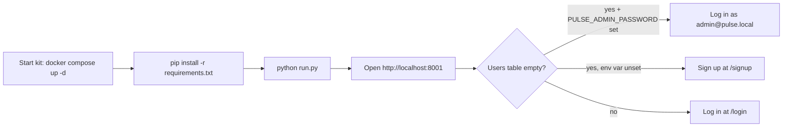

# README_PRODUCT.md — Pulse product guide

> Product guide for running and using Pulse. Companion documents:
> [DESIGN.md](DESIGN.md) (how it works internally) ·
> [PROJECT_PLAN_V2.md](PROJECT_PLAN_V2.md) (objectives, phases, roadmap) ·
> [PROGRESS_STATUS.md](PROGRESS_STATUS.md) (what is done and verified).

## Introduction

Pulse is a status and incident hub for Acko's mock microservices (the starter
kit's `quotes`, `payments`, `claims`, `notifications`). It continuously
health-checks each registered service, notices degradation and outages in
seconds, opens an incident with a readable timeline, alerts a webhook
receiver, and proves reliability against per-service targets. Engineers get an
operator dashboard behind a login, support teams get sanitized webhook alerts,
and customers get a public status page that can never leak internal error
text.

## Features

All features below are implemented and tested — see
[PROGRESS_STATUS.md → Completed features](PROGRESS_STATUS.md#completed-features)
for the evidence map and [DESIGN.md](DESIGN.md#system-architecture) for the
internals:

- **Service catalogue** — register/edit via API or dashboard form; pre-seeded
  with the kit's four services.
- **Isolated health checking** — one asyncio task per service, per-request
  timeout, every attempt stored with latency, status and error class.
- **Deterministic state machine** — `unknown / healthy / degraded / down`;
  3 consecutive failures → down, 2 confirmed consecutive fast successes →
  recovery; slow-but-up services degrade instead of failing.
- **Incident lifecycle** — auto-open on down, auto-resolve on recovery,
  one-click ack, notes, manual resolve, append-only timeline, MTTD/MTTR
  recorded.
- **Webhook notifications** — sanitized `incident_opened` /
  `incident_resolved` payloads, 3 attempts with backoff, every attempt logged
  and visible per incident.
- **Reliability and error budget** — 1 h/24 h/7 d uptime % vs per-service
  target, budget used/left.
- **Product metrics** — `/metrics` page + `/api/metrics`: MTTD, MTTR, checker
  success rate and p50/p95/p99 latency, webhook delivery rate.
- **Public status page** — plain-English states, auto-refresh every 10 s,
  sanitized by construction.
- **Operator login and self-service signup** — bcrypt-hashed accounts in the
  existing SQLite database, signed session cookies (24 h), show/hide password
  inputs with live validation feedback, per-field error messages,
  mobile-responsive design; public reads stay open without login.

Planned but **not** implemented (flap suppression, password reset,
role-management UI, non-HTTP checks, …) —
[PROJECT_PLAN_V2.md → Future roadmap](PROJECT_PLAN_V2.md#future-roadmap).

## Technology stack

Python 3.12 · FastAPI + Uvicorn · httpx (async) · Jinja2 (server-rendered, no
JS build) · SQLite (WAL, single guarded connection) · bcrypt + itsdangerous
sessions · pytest + pytest-asyncio · Docker Compose (starter kit; optional
Pulse container).

## Installation and setup

Prerequisites: **Python 3.12+** and **Docker Desktop** (for the mock kit).

```bash
# 1. Start the mock kit: 4 services on :7001-7004 + webhook receiver on :9900
cd pulse-starter-kit          # the folder containing its docker-compose.yml
docker compose up -d

# 2. Install and run Pulse (default port 8001)
cd pulse
pip install -r requirements.txt
python run.py
```

First run walkthrough:



## Configuration

All environment variables are optional (defaults verified in
`pulse/config.py`):

| Variable | Default | Meaning |
|---|---|---|
| `PULSE_PORT` | `8001` | web + API port (8000/8080 clash with other projects on this laptop) |
| `PULSE_HOST` | `127.0.0.1` | bind address (set `0.0.0.0` inside Docker) |
| `PULSE_DB` | `pulse.db` | SQLite path — accounts live in this same database |
| `PULSE_WEBHOOK_URL` | `http://localhost:9900` | default webhook target (per-service override via the catalogue) |
| `PULSE_TARGET_BASE` | `http://localhost` | base URL used when seeding kit services (inside Docker: `http://host.docker.internal`) |
| `PULSE_SEED` | `1` | set `0` to disable seeding the kit's four services |
| `PULSE_ADMIN_EMAIL` | `admin@pulse.local` | email for the bootstrap admin |
| `PULSE_ADMIN_PASSWORD` | *(unset)* | when set and the users table is empty, creates the first admin at startup; when unset, the startup log points at `/signup` — **no password is ever generated or logged** |
| `PULSE_SECRET` | *(random per process)* | session-cookie signing key; set it to keep logins across restarts (a warning is logged when unset) |

## Docker setup

Two compose files exist:

- **Starter kit** (`pulse-starter-kit/docker-compose.yml`, provided by the
  kit — do not modify): builds `quotes :7001`, `payments :7002`,
  `claims :7003`, `notifications :7004` from `./mock-service` and a
  `webhook-receiver :9900` (host port from `WEBHOOK_PORT`, default 9900).
- **Pulse** (`pulse/docker-compose.yml`, optional — `python run.py` on the
  host is enough): builds the provided `Dockerfile` (python:3.12-slim), binds
  host **8001 → container 8000**, stores the database in the `pulse-data`
  volume, and reaches host services via `host.docker.internal`
  (`PULSE_TARGET_BASE`, `PULSE_WEBHOOK_URL` preconfigured).

```bash
cd pulse && docker compose up --build   # then open http://localhost:8001
```

## Running

- **Laptop:** `python run.py` → open **http://localhost:8001**.
- **Container:** the compose file above.
- **Login:** anonymous visits to `/` (or any operator page) redirect to
  `/login?next=…`; sign in and you are returned to where you started. See
  [Login and signup](#login-and-signup).
- **Public surfaces (no login):** `/status` (auto-refresh 10 s), `/metrics`,
  `/docs` (OpenAPI).

## Login and signup

- **Register:** open **http://localhost:8001/signup** (linked from the login
  page). Name, email, password (≥ 8 characters, show/hide 👁 toggles, live
  length hint, confirm-match feedback). Server-side validation re-checks every
  rule and shows per-field errors; duplicate emails get an inline
  "already registered" message. On success you are signed in and land on the
  dashboard with role `operator`.
- **Log in:** **http://localhost:8001/login** — email + password; a wrong
  combination shows "Invalid email or password." in a red banner (the typed
  password is never re-rendered). Sessions last 24 h or until logout
  (header button).
- **Admin account:** on a fresh database, set `PULSE_ADMIN_PASSWORD` before
  starting Pulse and log in as `admin@pulse.local` (or
  `PULSE_ADMIN_EMAIL`). If the table is empty and the variable is unset, the
  startup log points at `/signup` — no secret is ever printed. Admins can
  create additional accounts with any role via `POST /api/users`.
- **Protected surfaces:** dashboard `/`, service and incident pages, ack /
  note / resolve actions, and every mutating API call. **Public without
  login:** `/status`, `/metrics`, and all read-only API GETs.

## Usage guide

After logging in at `http://localhost:8001`:

- **Dashboard** — per-service state, 24 h uptime, target, open incident;
  register new services via the form; auto-refreshes every 5 s.
- **Service page** — reliability card (1 h/24 h/7 d uptime + error budget),
  last 25 checks with friendly error text, incident history.
- **Incident page** — full timeline (opened → details → ack/notes → resolved)
  and webhook delivery audit; ack, note, resolve buttons.
- **`/status`** — the customer-facing page; what customers see is exactly
  what Pulse shows publicly.
- **`/metrics`** — product health of Pulse itself.

60-second demo drill (kit control endpoints):

```bash
curl -X POST localhost:7003/control/down            # break claims → incident + webhook
curl -X POST localhost:7003/control/reset           # heal → auto-resolve + webhook
curl -X POST "localhost:7002/control/slow?ms=3000"  # degraded, no incident
curl -X POST "localhost:7001/control/flaky?rate=0.3"
```

## API overview

Full endpoint table with auth semantics:
[DESIGN.md → API design](DESIGN.md#api-design). Quick reference — reads are
public; mutations need a login session; `POST /api/users` needs the admin
role:

- `POST /api/login` · `POST /api/logout` · `GET /api/me` ·
  `POST /api/register` (public signup) · `POST /api/users` (admin)
- `GET|POST /api/services`, `GET|PATCH|DELETE /api/services/{id}`
- `GET /api/status`, `GET /api/incidents[?state=]`,
  `GET /api/incidents/{id}`
- `POST /api/incidents/{id}/ack | /notes | /resolve` (login)
- `GET /api/metrics`

Errors: `401` unauthenticated · `403` non-admin · `404` unknown · `409`
conflict · `422` validation.

## Testing

```bash
python -m pytest tests -q                  # 92 unit + integration tests, no kit needed
python -m pytest tests -q -m acceptance    # 9 acceptance tests; needs kit + Pulse running
python -u scripts/verify_nav.py            # live navigation check (logs in as admin)
python -u scripts/verify_auth.py           # 22-check live login/DB-integrity check
```

The acceptance module auto-skips when the kit or Pulse is not reachable, so
the default suite never fails on a laptop without Docker. Layer details:
[PROGRESS_STATUS.md → Test coverage](PROGRESS_STATUS.md#test-coverage).

## Troubleshooting

| Symptom | Cause and fix |
|---|---|
| Dashboard shows every service `down`, checker success 0% | The mock kit is not answering — verify the containers (`docker compose ps` in the kit folder). Pulse is reporting faithfully, not malfunctioning. |
| `docker ps` hangs / Docker Desktop unresponsive | The Docker engine (WSL2) froze. Quit and relaunch Docker Desktop; if `wsl -l -v` also hangs, `wsl --shutdown` then relaunch. Containers and volumes are preserved. |
| Pulse cannot bind its port | 8000/8080 are taken by other projects on this laptop — keep the default `PULSE_PORT=8001`. |
| Logins vanish after a restart | `PULSE_SECRET` is unset, so the session key is per-process random. Set it to persist sessions. |
| "Invalid email or password" although the account exists | Emails are case-insensitive (stored lowercase); passwords are bcrypt-verified. Create a new account at `/signup` or a new admin via `PULSE_ADMIN_PASSWORD` on an empty users table. |
| Webhooks show as failed | The receiver must be up; 3 attempts are made and every failure is logged in `notifications` and on the incident timeline. |
| Latency percentiles read 0 ms during an outage | Expected today — failed checks record no latency (roadmap item 2). Success rate stays accurate. |
